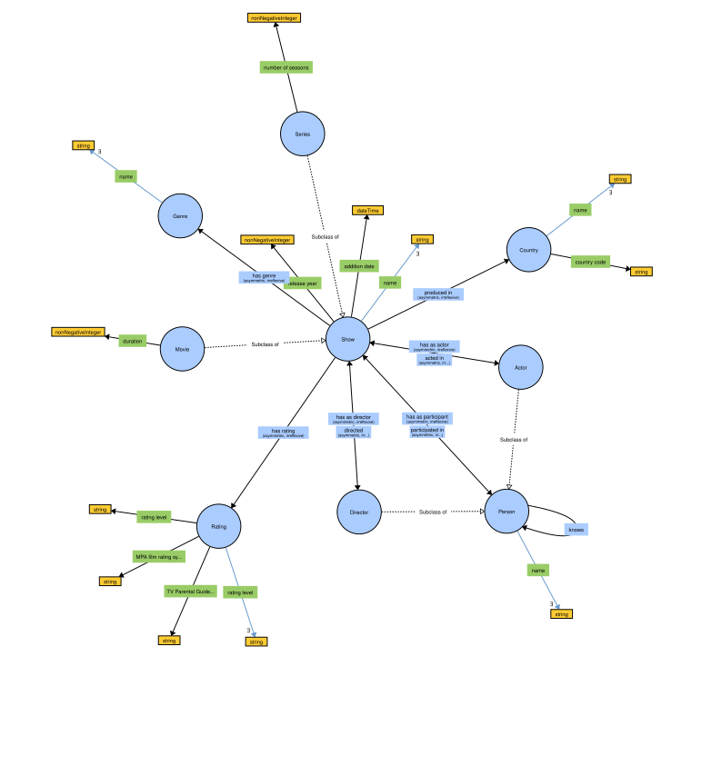

# Show Catalog Ontology and Information System

A movie and TV show catalog developed for the Knowledge Representation and
Reasoning course. The project combines a PostgreSQL database built from the
Netflix Movies and TV Shows dataset with an OWL 2 QL ontology, converts relational
data into RDF, and supports searches through SPARQL.

## Project Overview

The data flows through four stages:

```text
Netflix CSV -> PostgreSQL -> R2RML mapping -> RDF -> Fuseki / SPARQL
```

- **Data preparation:** a Python notebook cleans the source dataset and splits
  it into CSV tables for shows, people, countries, genres, ratings, and their relationships.
- **Relational database:** the import script creates PostgreSQL tables and loads
  the prepared CSV files.
- **Ontology and mapping:** the ontology defines concepts such as Show, Movie,
  Series, Person, Actor, and Director. R2RML maps SQL data to RDF resources and
  relationships, including people who participated in the same show.
- **Querying and documentation:** Fuseki serves the RDF dataset through SPARQL.
  The ontology documentation and WebVOWL graph explain its classes and relationships.

### Ontology Diagram



Open the [full-size diagram](docs/ontology.svg) to zoom in.

## Quick Start

Install and start [Docker Desktop](https://docs.docker.com/desktop/setup/install/windows-install/)
with the Linux container engine. Docker provides Python, Java, PostgreSQL, and
Fuseki inside containers; these tools do not need separate local installations.

From the project directory, run:

```powershell
docker compose up --build --wait
```

The first run downloads the images and Apache Jena Fuseki 6.2.0, verifies its
SHA-512 checksum, imports the prepared CSV files into PostgreSQL, and generates
RDF using the mapping. It then starts Fuseki and the documentation server in the
background and waits for the services to respond. CSV preprocessing is already
done; the preprocessing notebook is available for exploring the source data.

Allow several minutes and an Internet connection for the first run. Local ports
**5432**, **3030**, and **8000** must be available. Services listen only on this machine.

## Usage

| Service | Address |
| --- | --- |
| Fuseki SPARQL interface | [localhost:3030](http://localhost:3030/) |
| SPARQL endpoint | [localhost:3030/ds/query](http://localhost:3030/ds/query) |
| Ontology documentation | [localhost:8000/index-en.html](http://localhost:8000/index-en.html) |
| WebVOWL graph | [localhost:8000/webvowl/index.html](http://localhost:8000/webvowl/index.html) |

Open Fuseki, select the `/ds` dataset, and paste a query from
[SPARQL.ipynb](submit/SPARQL.ipynb). The six examples cover retrieving a title,
filtering by release year or duration, aggregating movies by country, and finding
movies through relationships between participants.

For example, this query returns movie titles and durations over 90 minutes:

```sparql
PREFIX show: <http://ontology.show-catalog.org/show#>

SELECT ?title ?duration
WHERE {
  ?movie a show:Movie ;
         show:name ?title ;
         show:duration ?duration .
  FILTER (?duration > 90)
}
LIMIT 100
```

For direct SQL access, PostgreSQL is available at `localhost:5432`, with database
`show_catalog`, user `postgres`, and local development password
`show_catalog_local`. These settings are defined in [compose.yaml](compose.yaml).
The SQL examples in `submit/Database/requestSQL.ipynb` need their connection settings
adjusted to this database before use.

## Managing the Local Setup

Use the Quick Start command again to relaunch the project or rebuild it after
code or mapping changes. PostgreSQL data and the generated RDF are stored in
Docker volumes. The original submitted export, `submit/output.ttl`, is preserved.

On startup, `scripts/prepare.py` checks row counts in all ten SQL tables. It imports
the CSV files only when the tables are empty and skips the import when counts
already match. A partially populated database or different CSV row counts cause
an explicit error without deleting existing data. Row-count checks do not detect
content changes that leave counts unchanged; dataset changes require an explicit
migration.

Stop the services while keeping their data:

```powershell
docker compose down
```

Inspect service status and logs:

```powershell
docker compose ps -a
docker compose logs --tail=100 prepare fuseki
```

The `prepare` service exits successfully after generating the RDF; PostgreSQL,
Fuseki, and the documentation server keep running. If ports are occupied by an
older manual setup, stop those services before starting Compose. This configuration
is intended for local development.

## Original Ubuntu Deployment

The original project used Ubuntu 22.04.4, OpenJDK 17.0.10, PostgreSQL, Fuseki,
Pubby, Jetty, and Apache2. The following instructions document that deployment.
The Docker setup above uses Java 21 and provides Fuseki and static ontology
documentation. Pubby is separate, and its supplied configuration still targets
DBpedia; adapt it to the catalog endpoint and resource URIs before use.

### SPARQL Endpoint

Add `127.0.0.1 data.show-catalog.org` to `/etc/hosts`, start Fuseki with
`./fuseki-server`, create a dataset named `ds`, and upload `submit/output.ttl`.

### Linked Data Frontend

Build Pubby:

```bash
mvn package -DskipTests -Dmaven.javadoc.skip=true
```

Replace `./target/pubby/WEB-INF/config.ttl` with the adapted
`submit/Deployment/config.ttl`. Rename the built Pubby directory to `ROOT`, copy
it into Jetty's `webapps` directory, and start Jetty:

```bash
java -jar start.jar
```

### Ontology Documentation

Add `127.0.0.1 ontology.show-catalog.org` to `/etc/hosts`. Copy
`submit/Deployment/show/` into `/var/www/` and
`submit/Deployment/ontology.conf` into `/etc/apache2/sites-available/`, then run:

```bash
sudo a2ensite ontology.conf
sudo systemctl reload apache2
```

Documentation can be regenerated with Widoco. With this deployment configured,
the ontology documentation is available at
[ontology.show-catalog.org/show](http://ontology.show-catalog.org/show), and the
linked data frontend at [data.show-catalog.org](http://data.show-catalog.org).

## Authors

- **Alexia Donati** (s200742)
- **Lei Yang** (s201670)
- **Bruce Andriamampianina** (s2302253)

Original course project: May 20, 2024.

## References

- Michael DeBellis. *A Practical Guide to Building OWL Ontologies using Protégé 5.5 and Plugins*, 2021.
- Daniel Garijo. *WIDOCO: a wizard for documenting ontologies*, International Semantic Web Conference, 2017.
- Steffen Lohmann et al. *WebVOWL: Web-based Visualization of Ontologies*, Knowledge Engineering and Knowledge Management, 2015.
- OWL Working Group. *OWL 2 QL*, 2009. [Link](https://www.w3.org/TR/2009/WD-owl2-new-features-20090421/#OWL_2_QL)
- Bansal Shivam. *Netflix Movies and TV Shows*, 2022. [Link](https://www.kaggle.com/datasets/shivamb/netflix-shows/data)

## Additional Features

The [query performance notebook](new_features/query_performance.ipynb) compares
SQL and SPARQL on movie searches and paths connecting Tom Holland to Brad Pitt
through one or three intermediaries. All queries are embedded in the notebook,
alongside repeated measurements and validation against the source data.

SPARQL expresses these connections through compact graph patterns, making
relationship queries easier to write without explicit table joins. Local
benchmarks also show faster responses for the deeper actor-connection query.
Open the notebook in Jupyter or VS Code and select **Run All** after starting
the local services to explore the examples and repeat the measurements.

### Performance Results

Results from 18 November 2026, using the median of five repetitions after the
first measured execution:

| Query | Results returned | SQL median (ms) | SPARQL median (ms) |
| --- | ---: | ---: | ---: |
| Movies longer than 90 minutes | 20 | 0.768 | 5.577 |
| Tom Holland to Brad Pitt: one intermediary | 2 | 14.528 | 6.666 |
| Tom Holland to Brad Pitt: three intermediaries | 20 | 165.724 | 18.123 |

SPARQL was approximately **2.18 times faster** for the one-intermediary query
and **9.14 times faster** for the three-intermediary query. SQL was faster for
the simple movie-duration filter.

Measurements include response transfer and decoding, with connections established
before timing and caches left in place. Each result was checked against the source
CSVs. Queries use `LIMIT 20` without `ORDER BY`, so the engines may return different
valid subsets. These local measurements do not imply that either engine is always faster.

The notebook also displays the first execution and the minimum and maximum
repetition times.
